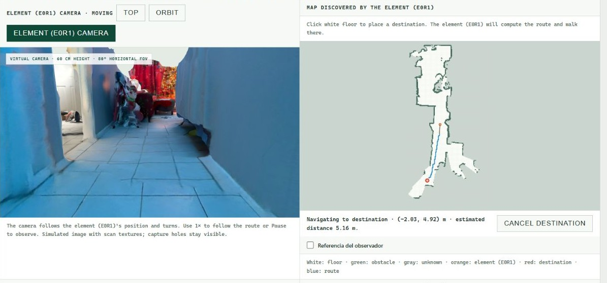
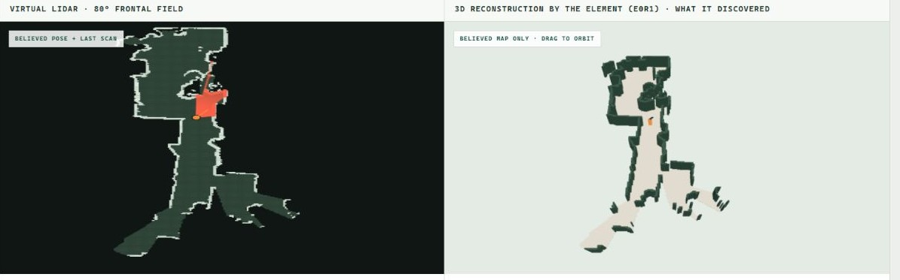

# HomeMind

[English](README.md)

Un prototipo inicial de una capacidad de autonomía reutilizable para robots: mapear su entorno, estimar dónde están y navegar hacia distintos destinos.

## Qué hace hoy

La demo funciona en el navegador sobre el escaneo de una habitación real. **El robot, sus sensores y su movimiento son simulados.**

- **Mapeo y exploración autónoma:** construye un mapa 2D con lecturas de profundidad virtual, distinguiendo espacio libre, obstáculos y zonas desconocidas.
- **Estimación de posición:** sigue la ubicación y orientación del robot a partir de su movimiento simulado, con ruido de sensores opcional.
- **Navegación y planificación de rutas:** avanza hacia destinos elegidos en el espacio descubierto y recalcula la ruta si encuentra un bloqueo.
- **Visualización y exportación:** muestra la cámara virtual, el mapa de sensores y la reconstrucción 3D; permite exportar mapas, resúmenes del recorrido y observaciones de IA.

Es un prototipo supervisado. La exploración puede detenerse sin cubrir toda la habitación.

**En desarrollo — reconocimiento de objetos:** hay pruebas iniciales con Muse Spark y SAM mediante llamadas reales a Meta. El reconocimiento y su conexión con la navegación todavía no están totalmente integrados. El flujo completo de reconocer un objeto y acercarse a él sigue en desarrollo y validación.



*Navegación simulada hacia un destino elegido manualmente.*



*Espacio descubierto representado como mapa de sensores y reconstrucción 3D.*

## Objetivo final

Desarrollar una capacidad que distintos robots físicos puedan utilizar para moverse con mayor independencia. A futuro podría apoyar tareas de vigilancia, inventario o regreso a una estación de carga cuando la batería esté baja.

Falta completar la integración entre reconocimiento y navegación, buscar objetos fuera de la vista actual, recordarlos entre observaciones y validar el sistema con hardware real. Las aplicaciones mencionadas, el retorno por batería baja, el acoplamiento y la carga física siguen pendientes.

## Probarlo

Requiere Node.js 22.12+ y un navegador con WebGL 2.

```sh
npm ci
npm run dev
```

Abre [la demo principal](http://127.0.0.1:5173/scan-navigation.html). Puedes elegir **ES** o **EN**. Los escaneos están incluidos.

Para probar la integración experimental de IA, copia `.env.example` a `.env`, añade tu clave de Meta en `MODEL_API_KEY` y reinicia. La navegación funciona sin clave. Las pruebas de IA necesitan `npm run dev`; la vista estática no incluye ese servicio.
