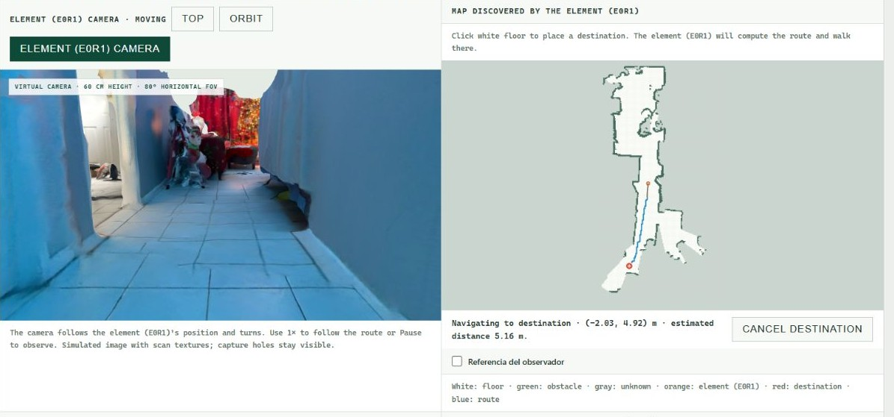
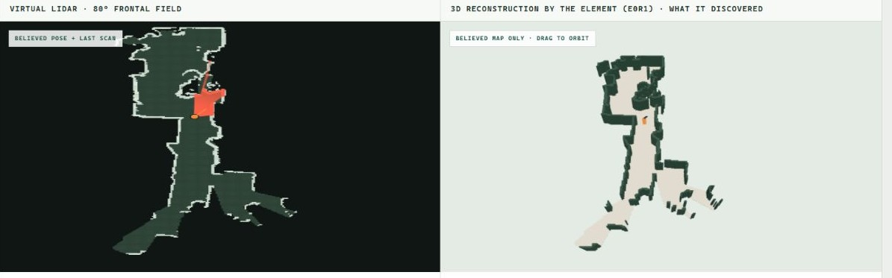

# HomeMind

[Español](README.es.md)

An early prototype exploring how a home robot could understand a request and move toward the right object.

## What works today

The demo runs in a browser using a scan of a real room. **The robot, its sensors and its movement are simulated.**

- **Mapping & autonomous exploration:** builds a 2D map from virtual depth readings, distinguishing free space, obstacles and unknown areas.
- **Pose estimation:** tracks the robot's position and heading from simulated motion readings, with optional sensor noise.
- **Navigation & route planning:** moves toward selected destinations in discovered space and replans when a route is blocked.
- **Object recognition & segmentation:** on request, Muse Spark interprets the camera image and SAM outlines a visible target through real Meta API calls.
- **Object localization & approach:** estimates the target's position using virtual depth and attempts to reach a nearby point when a known route is available.
- **Visualization & export:** shows the virtual camera, sensor map and 3D reconstruction; exports maps, run summaries and AI observations.

This is a supervised prototype. Exploration can stop before covering the whole room, and an AI observation does not guarantee that the robot can reach the object.



*Simulated navigation toward a manually selected destination.*



*Discovered space shown as a sensor map and a 3D reconstruction.*

## Where we want to go

A physical robot that responds to requests such as **“go to the charger”**: finding the target, reaching it and, eventually, docking.

We still need to search for objects outside the current view, remember them across observations, and validate the system on real hardware. Physical docking and charging have not been demonstrated.

## Try it

Requires Node.js 22.12+ and a browser with WebGL 2.

```sh
npm ci
npm run dev
```

Open [the main demo](http://127.0.0.1:5173/scan-navigation.html). Select **EN** for English. The room scans are included.

For object recognition, copy `.env.example` to `.env`, add your Meta API key as `MODEL_API_KEY`, and restart. Navigation can run without a key. Use `npm run dev` for the AI demo; the static preview does not include the AI service.

[Delivery note](ENTREGA-2026-11-04.md) · [Project scope](docs/PROJECT_CONTEXT.md)
